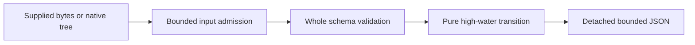

# Lease-fencing Model Lab

Model supplied numeric resource admission without acquiring a lease or writing
to a real resource. Lower tokens are rejected, equal tokens accepted unchanged,
and higher tokens accepted while advancing a supplied high-water. Numeric
acceptance does not authenticate a holder, issuer or generation. An explicitly
unknown model basis yields incomplete/null decisions after full validation.

This is an offline learning tool with Python standard-library runtime
dependencies only. Requires Python 3.10+; verified here on Windows/Python3.13.7.
No account, installation, Redis/etcd service, clock or network access is needed.

## Run

From this directory:

```powershell
python -m fencing_lab examples/delayed.json
python -m fencing_lab examples/unknown.json
python -m unittest discover -v
python -O -m unittest discover -v
python scripts/report_bound.py
# Bandit must already be installed; the verifier never installs it.
python scripts/verify.py --output .test-tmp/fresh-verification
```

The delayed example receives token34, then33, then34: advance, stale rejection,
equal acceptance. Holder labels are descriptive. Every report keeps issuance,
identity, authorization, lease validity, retention, atomic enforcement and mutual
exclusion unverified; effects unmodeled. The empty unknown example still has null
inferred counts and final state. Exit0 covers modeled AND incomplete reports;
inspect `state`. Exit2 means input, argument, limit, file or output error.

Success output is compact ASCII JSON plus LF. Error stderr is fixed
`{"error":"CODE"}` plus LF, without paths or supplied text. Help is ASCII.
Closed/missing/failed/short sinks return2 when used. Output is checked before
delivery, but bytes already delivered cannot be rolled back. Lost stderr means
the diagnostic cannot be delivered; the error exit remains.

## Input and Python interface

Root fields: `profile`, `model_basis`, `initial_high_water`, `requests`.
Profile must be `fence-high-water/1`. Basis is
`assumed_monotonic_retained_atomic` or `unknown`, with no implicit default.
Seed is an exact integer0..1,000,000,000. Each request has exact fields
`request_id`, `holder`, `token`; labels are1..32 ASCII letters/digits/underscore/
hyphen, unique request IDs and token1..1,000,000,000. Array order is arrival
order. Equal tokens with different holder labels still receive numeric
acceptance, not ownership proof, replay detection or exactly-once effects.

```python
from pathlib import Path
from fencing_lab import LabError, model, render

report = model(Path("examples/delayed.json").read_bytes())
print(render(report), end="")
```

`model` also accepts an exact built-in tree; caller inputs are unchanged and
results detached. Native subclasses/custom objects/keys, cycles and container
aliases are rejected before behavior. Concurrent caller mutation is not
contained. `render` bounds its own ordinary tree and returns ASCII text; callers
handle their own delivery. See [SCHEMA.md](SCHEMA.md) for the frozen contract.

## Architecture and bounds



| Boundary | Ceiling |
|---|---:|
| Raw JSON bytes | 65,536 |
| Container depth, root=1 | 8 |
| Requests / any array | 128 |
| Input keys / values excluding keys | 512 / 4,096 |
| Decoded string characters / encoded body bytes | 128 / 1,536 |
| Numeric spelling characters | 16 |
| Rendered report bytes including LF | 262,144 |

Raw depth/width guards precede stdlib JSON decoding; decoded array/key/value
counts remain postallocation checks. The renderer uses a separate fixed2,048-key
ceiling for report rows. These are computation/data budgets, not hard process
memory/time isolation. Stable regular-file checks include descriptor/growth
tests but cannot isolate hostile replacement races, mounts or device namespaces.

## Verification and limits

27 tests pass normally, under `-O`, and after restoring deliberate mutants.
Coverage includes20 full pre-code reports/8 fixed errors,1,456 independent
prefix-max traces,42 actual CLI subprocesses per normal/optimized suite and
input/stream boundary seams. Four mutants caused16/17/19/11 assertion failures
with zero other errors; copied source restored exactly and originals unchanged.
Bandit1.9.4 reports zero findings/errors for application/scripts with four
narrow harness annotations; no application suppression. This is finite evidence
and Codex self-review, not an independent audit or real distributed protocol test.

A genuine128-request sample is14,591 input/30,552 report bytes. A separate
independent field-width envelope is31,695 bytes; it combines incompatible maxima
and is NOT a reachable trace. Both fit262,144. Reduced-cap tests are labeled
defensive seams. [VERIFICATION.md](VERIFICATION.md) links raw evidence and gaps.

No real leases/locks/issuers/storage/effects, clocks, services, consensus,
availability, authentication, authorization, durability or exactly-once
guarantees. A forged higher token can advance numeric state and exclude later
lower tokens. A fresh invocation is a fresh supplied model, not proof of retained
state. Lease-expiry-only comparison is documented in [PLAN.md](PLAN.md), not
implemented as another profile. Linux/other Python versions, hosted CI/CodeQL,
real distributed systems, exhaustive fuzzing/RSS/time and hostile filesystem
behavior remain unverified. No project Git repository or publication.

## Attribution and learning

Original work MIT licensed, copyright2026 Jake Franciosa. Input/CLI patterns
adapted from Jake's reviewed MIT bounded-queue-admission-lab (and its owned
structured-log provenance), with different alias/string/key/error policies.
No sibling runtime import or modification; no etcd/redis-py code copied.
[RESEARCH.md](RESEARCH.md) contains primary sources, pinned candidate assessment,
licenses and uncertainties. [SECURITY.md](SECURITY.md), [DECISIONS.md](DECISIONS.md)
and [LEARNING.md](LEARNING.md) record trust boundaries and useful concepts.

Codex assisted implementation/review/testing. Two bounded local Ollama prose
drafts were corrected; raw/metadata retained separately under .drafts. No remote
drafting, paid fallback or new model/dependency installation. Optional exercise:
explain why equal numeric tokens cannot prove a legitimate holder generation.

## Publication status

See [publication review](PUBLICATION.md) for the October 5 source snapshot, fresh local checks, evidence boundaries and current hosted-check distinction.
